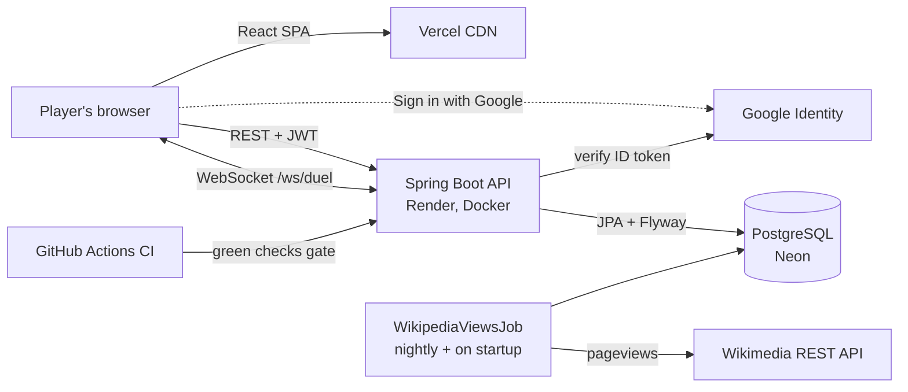

# SearchWars — Backend

[](https://github.com/1Dhairyak/searchwars-backend/actions/workflows/ci.yml)

Spring Boot API for **[SearchWars](https://search-wars.vercel.app)**: two things side by side, guess which one got
more English Wikipedia page views last month. One wrong guess ends your streak — solo, or live against a friend.

Frontend: [1Dhairyak/SearchWars](https://github.com/1Dhairyak/SearchWars) (React 19 + Vite on Vercel).

## Architecture



## What's interesting here

**The server owns the game.** The browser never sees the hidden number before it guesses: `/game/start` returns the
challenge item without `monthlyViews`, the session (seen items, score) lives in PostgreSQL, and `/game/guess` decides
right or wrong. Scores — and the leaderboard and "best score" built from them — can't be faked from the client.

**Real-time 1v1 duels over WebSockets.** A friend opens your invite link and you race through the *same* chain
of items, with live scores. The server is authoritative here too:
- [`Duel`](src/main/java/com/higherlower/game/duel/Duel.java) holds every rule as plain Java, unit-tested with a
  fixed clock. Views are frozen when the duel is created, so both players get identical questions even if the
  nightly refresh runs mid-match.
- You're out on a wrong guess, after 15 s without guessing, or after 15 s disconnected. The duel ends the moment
  the outcome is decided (opponent out and you're ahead), and a tie goes to whoever reached the score first.
- Plain JSON over a raw WebSocket, no STOMP. After every change each player gets a complete personal `state`
  (both scores, but only *their* round, with the hidden number withheld), so reconnecting is just joining again.
  Identity travels in the first message, never the URL, so tokens stay out of access logs.
- Duels live in memory: right for one Render instance. Several instances would need the state and the
  fan-out in Redis (or sticky routing by duel code).
- [`DuelSocketTest`](src/test/java/com/higherlower/game/duel/DuelSocketTest.java) plays a full match with two
  real WebSocket clients against the running server.

**Real data, refreshed automatically.** [`WikipediaViewsJob`](src/main/java/com/higherlower/game/service/WikipediaViewsJob.java)
pulls last month's views for every item from the [Wikimedia Pageviews API](https://wikimedia.org/api/rest_v1/)
nightly at 03:00 UTC, and again on startup when the data is over 20 hours old (Render's free tier sleeps, so a
cron alone would miss most nights).
- Each item is updated independently; one bad article never blocks the rest, and a failed item keeps its last value.
- Rate limits, 5xx and network errors retry with exponential backoff (3 attempts).
- The API counts the exact article only and doesn't follow redirects, so
  [`WikiArticles`](src/main/java/com/higherlower/game/util/WikiArticles.java) maps ambiguous titles to canonical
  articles ("Apple" → "Apple Inc.", "Twitter" → "X (social network)"), each checked against Wikipedia.

**Schema changes are migrations.** [Flyway](src/main/resources/db/migration) owns the schema and Hibernate only
`validate`s it at startup. Production predates Flyway, so it was adopted with `baseline-on-migrate` at V1; CI replays
exactly that upgrade on a real PostgreSQL before every deploy.

| Version | Change |
|---|---|
| V1 | Baseline: the schema as it existed in production |
| V2 | `search_volume` → `monthly_views` (Wikipedia data), add `views_refreshed_at` |
| V3 | Data fix: "McDonald s" → "McDonald's" |

**Identity without forcing sign-up.** Every device gets a random guest token. Sessions and the unique player name
belong to an *owner* — `g:<sha256(token)>` for guests (the raw token is never stored) or `u:<userId>` after login.
Signing in (email + BCrypt, or Google ID token) adopts the device's guest games and name, so your best score follows
you across devices.

**Shipping is gated.** GitHub Actions runs the test suite and a PostgreSQL upgrade job on every push and PR;
Render deploys `main` only after both pass.

## API

All game endpoints return `{ success, message, data }`.

| Method | Path | Notes |
|---|---|---|
| `POST` | `/api/game/start` | New session: known item (with views) + challenge item (views hidden) |
| `POST` | `/api/game/guess` | `HIGHER`/`LOWER` → correct?, revealed views, next round or game over |
| `GET` | `/api/leaderboard?limit=10` | Top scores (cached, evicted on new entries) |
| `POST` | `/api/players/name` | Claim a globally unique name (case-insensitive) for this device/account |
| `GET` | `/api/players/best` | Signed-in user's best score across devices |
| `POST` | `/api/duels` | Open a 1v1 duel → 6-character code; play it on `wss://…/ws/duel` |
| `POST` | `/api/auth/register` · `/login` · `/google` | Returns a JWT; adopts the guest's games |

Ties go to the player: guessing `HIGHER` on equal views counts as correct.

## Stack

Java 21 · Spring Boot 3.3 (Web, WebSocket, Data JPA, Security, Validation, Cache, Actuator) · PostgreSQL 16 (Neon) · Flyway ·
JJWT · Google API Client · JUnit 5, Mockito, MockMvc, MockRestServiceServer, H2 · Docker · GitHub Actions · Render

## Run locally

```bash
docker run -d --name searchwars-db -e POSTGRES_DB=higher_lower_db -e POSTGRES_PASSWORD=postgres -p 5432:5432 postgres:16
mvn spring-boot:run      # http://localhost:8080 — Flyway creates the schema, DataSeeder adds 100 items,
                         # then the Wikipedia job fills in real views
mvn verify               # tests (H2; Flyway builds the schema and Hibernate validates it)
```

## Project layout

```
src/main/java/com/higherlower/game/
  controller/   Game, Leaderboard, Player, Auth REST endpoints
  duel/         real-time 1v1: Duel (rules), DuelService (registry, sweeps), DuelSocketHandler (/ws/duel)
  service/      game loop, leaderboard, player names, WikipediaViewsClient + WikipediaViewsJob
  repository/   Spring Data JPA (random item selection, best score, owner reassignment)
  entity/       Item, GameSession, LeaderboardEntry, PlayerName, User
  config/       security (stateless JWT filter), seed data, name backfill
src/main/resources/db/migration/   Flyway SQL migrations
.github/workflows/ci.yml           tests + PostgreSQL upgrade job
```

Deployment (Render + Neon) is in [DEPLOY.md](DEPLOY.md).
